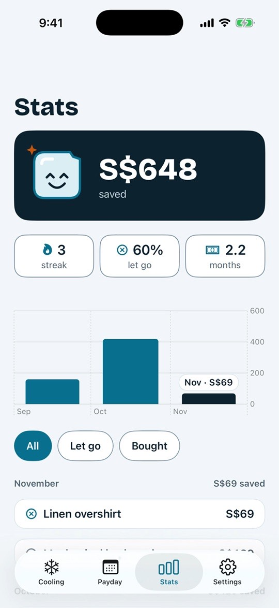
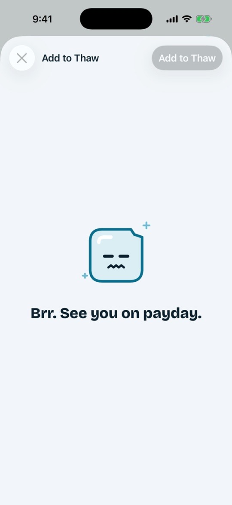
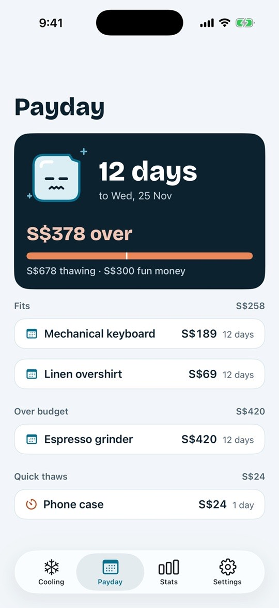
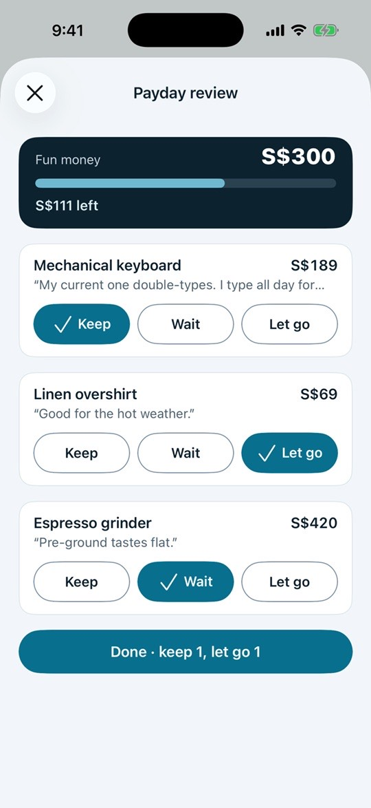

# Thaw

Thaw is an iPhone app that puts impulse purchases on ice until payday. You add something you want with its price and your reason. It cools until your next payday, and then you decide whether to **Keep** it, **Wait** another payday, or **Let go**, with your fun-money budget in view. Cubi, a small ice cube, reacts to your choices along the way.

**Website:** [seanyeote.github.io/thaw-cubi](https://seanyeote.github.io/thaw-cubi/) · [Privacy policy](https://seanyeote.github.io/thaw-cubi/privacy.html) · [Support](https://seanyeote.github.io/thaw-cubi/support.html)

| Stats | Freeze it | Let it cool | Decide on payday |
|---|---|---|---|
|  |  |  |  |

## Features

- **Payday rules:** same date every month, last working day, twice a month, or a fixed wait when pay isn't regular.
- **Fun-money budget:** the Payday tab and the review show what fits and what goes over.
- **Quick thaws:** wants under a set price wait a few days instead of a full pay cycle.
- **Share from Safari:** a Share extension adds the page as a want, keeping its link.
- **Stats:** total saved, payday streak, let-go rate, monthly chart and decision history.
- **Reminders:** local notifications when wants thaw, plus "Remind me tonight".
- **Accessibility:** Dynamic Type throughout, VoiceOver custom actions on list rows, and Cubi's animation respects Reduce Motion.
- **Privacy:** no accounts, servers or analytics. All data stays on the device.

Requires iOS 17 or later. Light mode only.

## Requirements and setup

1. Xcode 26 at `/Applications/Xcode.app`.
2. [XcodeGen](https://github.com/yonaskolb/XcodeGen): `brew install xcodegen`. The project is generated from `project.yml`; run `xcodegen generate` after editing it.
3. Open `Thaw.xcodeproj` and use the `Thaw` scheme.

A device build needs the app group `group.com.tinkercademy.thaw` registered once. Build from Xcode, or pass `-allowProvisioningUpdates` to `xcodebuild`.

## Build and test

```bash
export DEVELOPER_DIR=/Applications/Xcode.app/Contents/Developer
xcodebuild -project Thaw.xcodeproj -scheme Thaw -sdk iphonesimulator -derivedDataPath .build/dd build
xcodebuild -project Thaw.xcodeproj -scheme Thaw -destination 'platform=iOS Simulator,name=iPhone 17' -derivedDataPath .build/dd test
```

- **Unit tests (`ThawTests`)** cover:
  - payday rules and fun money;
  - store state and persistence round-trips;
  - progress stats;
  - notification scheduling;
  - Cubi motion;
  - every presenter, tested with fakes;
  - integration tests for editing and for Saved.
- **UI tests (`ThawUITests`)** cover the review flow, persona walkthroughs and the accessibility audits.

## Launch arguments

For simulator checks, screenshots and UI tests:

| Argument | Effect |
|---|---|
| `-thawReset` | Clears saved state and shows onboarding |
| `-thawFixture sprint1` | Four sample wants still cooling. Onboarding still shows. |
| `-thawFixture thawed` | Three wants ready to review, with default settings |
| `-thawFixture history` | Decided wants across three months, with default settings |
| `-thawTab cooling\|payday\|stats\|settings` | Opens on that tab (debug builds only) |

On the very first launch, debug builds seed sample wants and default settings. Use `-thawReset` for a clean start.

## Architecture

UIKit with one VIPER module per screen (contract: `docs/contracts/sprint-4-viper.md`). Modules live in `Thaw/Features/<Name>/`: AddWant, Home, ItemDetail, Payday, PaydayReview, PaydaySetup, Saved and StillWantIt.

| File | Role |
|---|---|
| `<Name>Contracts.swift` | View, Presenter, Interactor, InteractorOutput and Router protocols, plus plain view-model structs |
| `<Name>ViewController.swift` | UIKit only. Forwards events to the presenter and renders view models; no `WantStore` access. |
| `<Name>Presenter.swift` | Foundation only. Screen logic, validation and copy; holds the view weakly. |
| `<Name>Interactor.swift` | Wraps `WantStore`, `PaydaySettings` and `Reminders`; no UIKit |
| `<Name>Router.swift` | `createModule(...)` wires the module. Instance methods present and dismiss only what the router itself presented. |

- **State:** a single `WantStore`, persisted as JSON in Application Support and reached only through interactors. Changes reach presenters as `DataChange` notifications (interactor → presenter → view).
- **App shell:** `Thaw/App` (`SceneDelegate`, `RootTabBarController`, `ReviewRouter`) builds screens through `createModule`. `ReviewRouter` is the entry point for notification taps.
- **Domain:** payday rules, fun money and progress stats are in `Thaw/Models`. Persistence, the share inbox and notification scheduling are in `Thaw/Services`. Notification permission is requested on the first Add or the first settings save, never at launch.
- **Design system:** tokens and shared components are in `Thaw/DesignSystem`, shared list views in `Thaw/Features/Shared`. Display type is Bricolage Grotesque ExtraBold (`Thaw/Resources/Fonts`, SIL OFL 1.1); body text uses the system font.
- **Cubi:** `CubiArtwork` (drawing), `CubiMotion` (per-mood idle loops) and `CubiView`, with moods `frozen`, `thawing`, `thawed`, `proud` and `snoozing`. On Stats, the mood follows progress: frozen before any decision, proud during a payday streak, snoozing once the streak breaks.

### Share extension

`ThawShare` (`com.tinkercademy.thaw.share`) opens the Add form with the page title as the name and a read-only "From <host>" caption. It never touches `WantStore`. Instead it appends a `SharedDraft` to `inbox.json` in the app group. The app drains the inbox at launch and on returning to the foreground (`AppDelegate.ingestSharedDrafts`). Each draft keeps its own creation date as the freeze date and is ingested once.

The extension compiles a subset of app files (see `ThawShare` in `project.yml`). Anything added to that list must be extension-safe, so no `UIApplication`.

### Editing and deleting

One edit screen, the Add form in edit mode (`AddWantRouter.createModule(editing:)`), serves every list:

- **Cooling:** long-press a row for Edit or Delete, or open the detail and tap Edit.
- **Stats history:** swipe a row for Edit or Delete.
- **Decided wants:** these also offer **Move back to cooling** (which keeps the original thaw date) and **Mark as bought/skipped**.

List rows share `WantRowView` and `WantRowModel`, and every row action is also available as a VoiceOver custom action.

## Website

The marketing site is in [`site/`](site/): static HTML and CSS with no build step. It has the landing page, the privacy policy and the support page used for App Store Connect, plus short demo loops recorded from the simulator. [`.github/workflows/pages.yml`](.github/workflows/pages.yml) deploys it to GitHub Pages on every push to `main` that changes `site/`. See [`site/README.md`](site/README.md) to preview it locally, re-record the loops, or do the pre-launch steps.

## Project docs

| Path | Contents |
|---|---|
| `docs/contracts/` | Sprint contracts: scope, architecture and share/undo |
| `docs/qa/` | QA reports by sprint |
| `docs/design/` | Design handover and task briefs for the current round |
| `docs/screenshots/` | Persona walkthrough screenshots from the UI tests |
