# Thaw: Demo Presentation

*A 5-minute walkthrough. Each slide has one screenshot (or a small set) and a short talking point.*

---

## 1. The problem

**Impulse purchases happen in seconds. Regret lasts until the next bill.**

- Thaw puts what you want "on ice" until payday, then you decide.
- Cubi, a small ice cube, reacts to your choices.

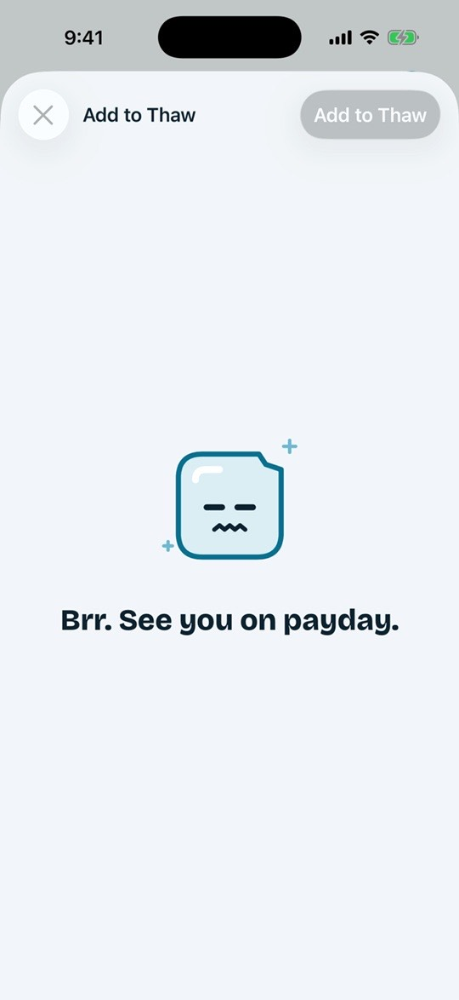

---

## 2. Set up in seconds: payday rules

Pick how you get paid: fixed date, last working day, twice a month, or a fixed wait.

| Onboarding | Last working day | Adjusted date |
|---|---|---|
| 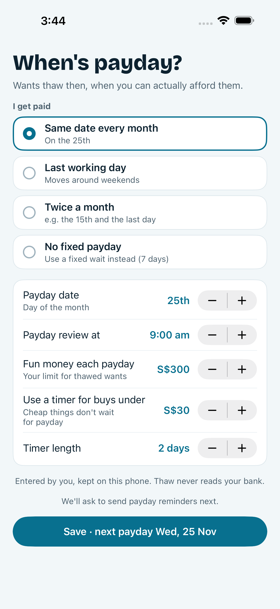 | 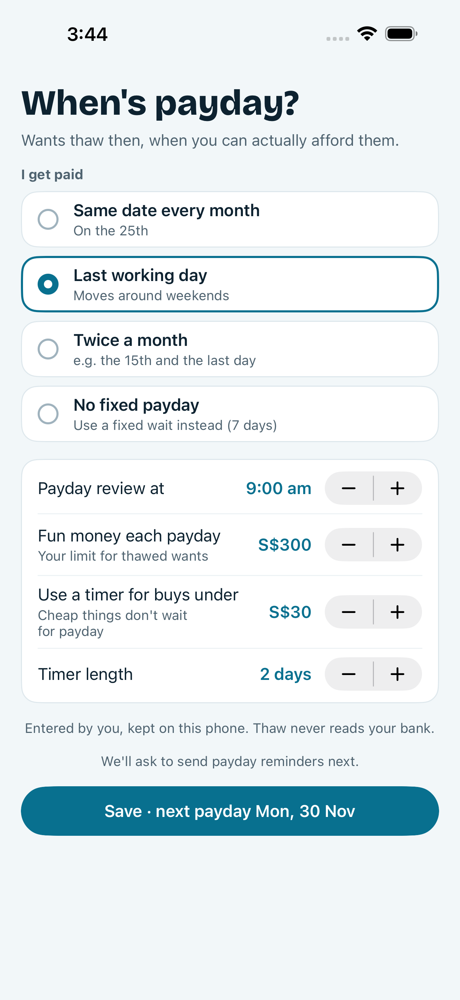 |  |

---

## 3. Freeze a want

Add the item, its price and your reason. It starts cooling immediately.

| Add a want | Cooling list | Item detail |
|---|---|---|
| 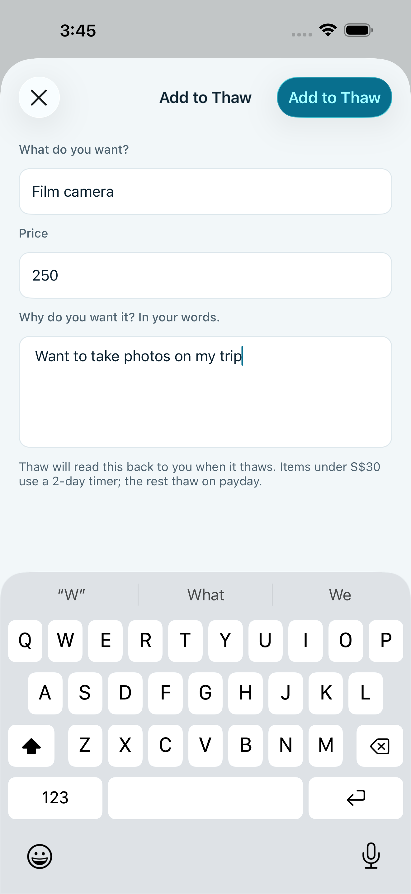 | 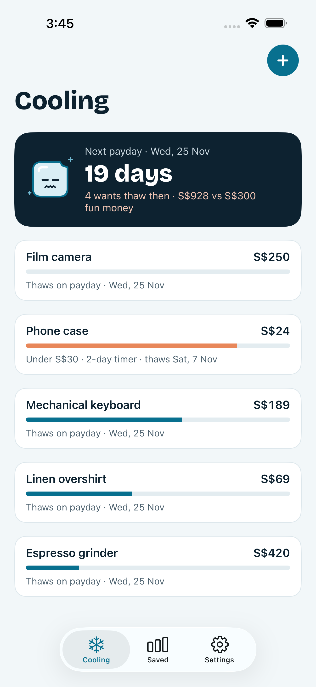 | 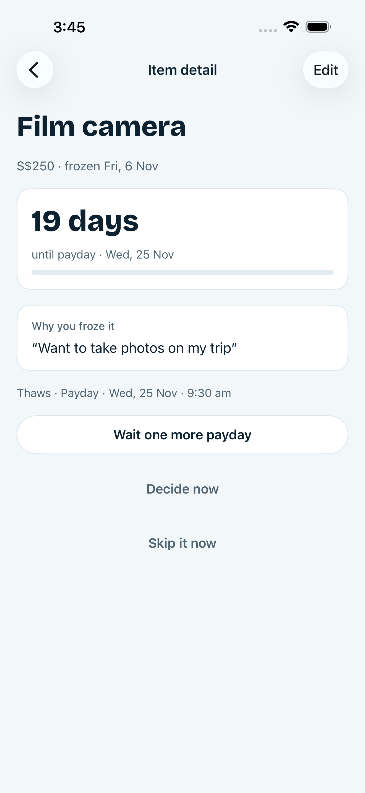 |

---

## 4. Add from anywhere: Share extension

Share a page from Safari and it becomes a want, with its link kept.

| Share sheet | Thaw extension |
|---|---|
| 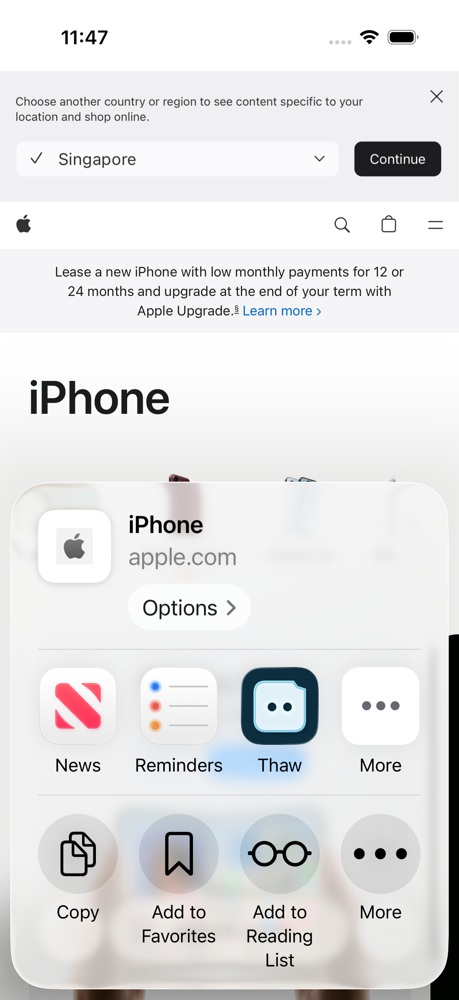 | 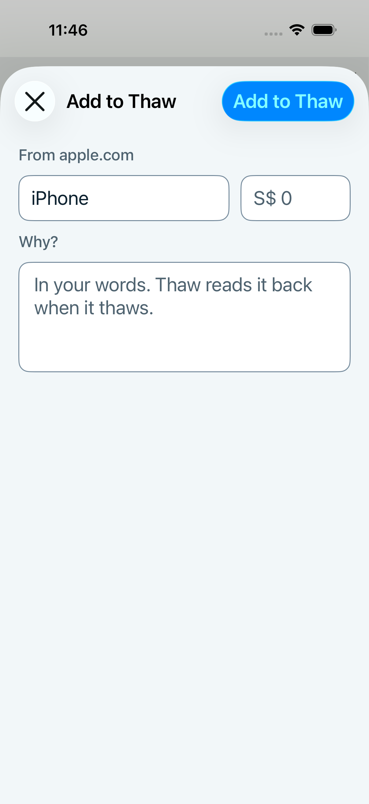 |

---

## 5. Let it cool

The Payday tab counts down. Small wants get a quick thaw of a few days.

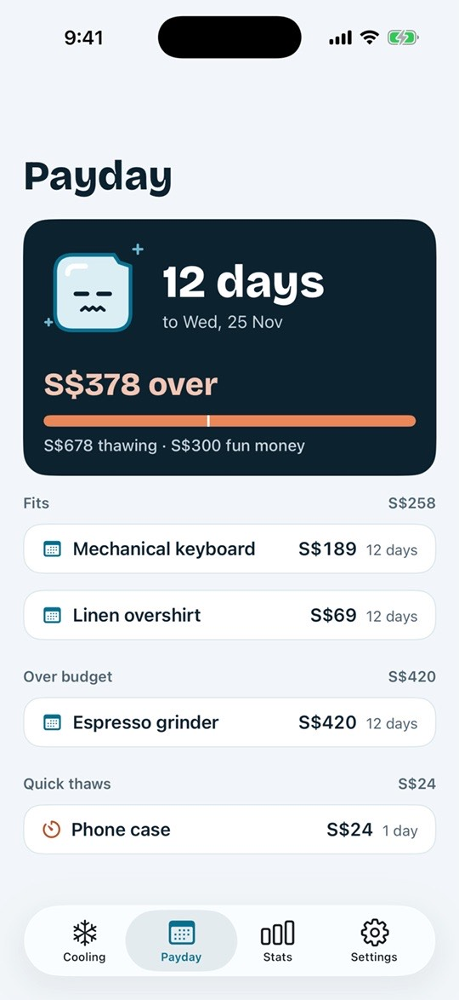

---

## 6. Reminders

Local notifications fire when wants thaw, plus "Remind me tonight".

| Launch | Payday banner | Timer banner |
|---|---|---|
| 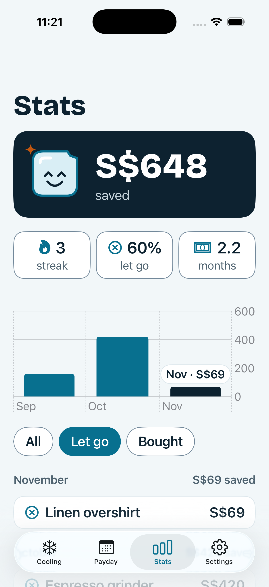 | 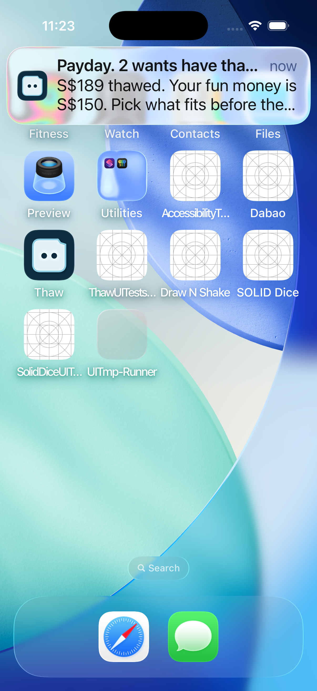 | 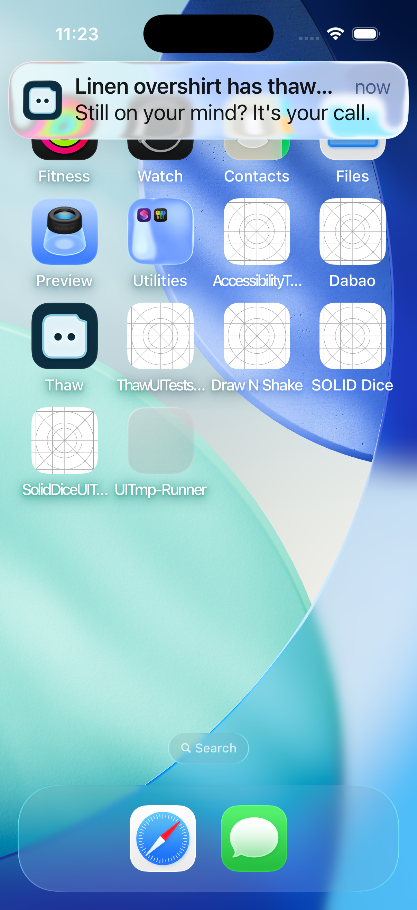 |

---

## 7. Payday: decide

For each thawed want choose **Keep**, **Wait** or **Let go**. Your fun-money budget stays in view.

| Ready to review | Review | Keep two | Over budget |
|---|---|---|---|
| 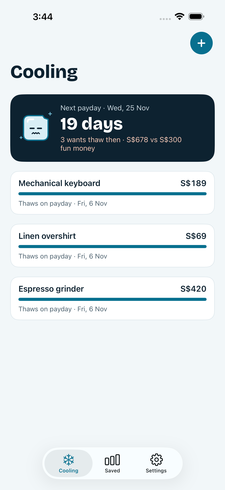 | 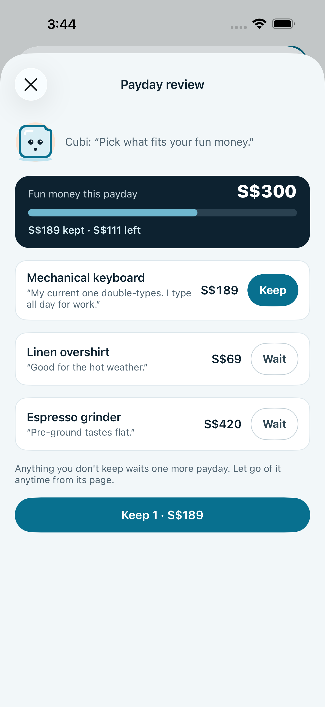 | 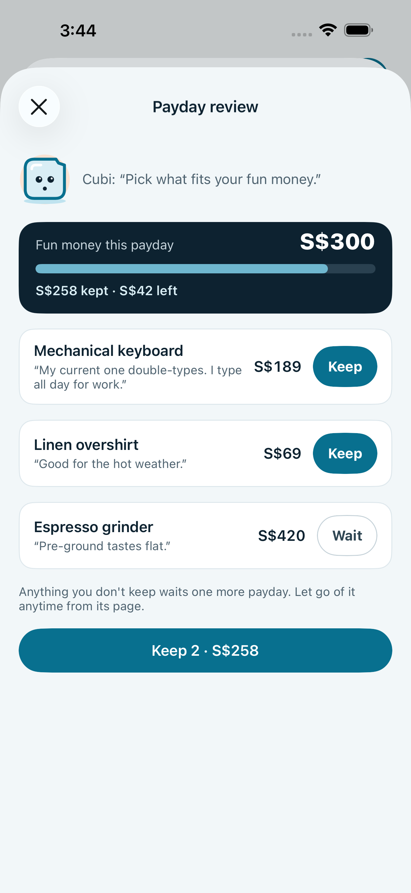 | 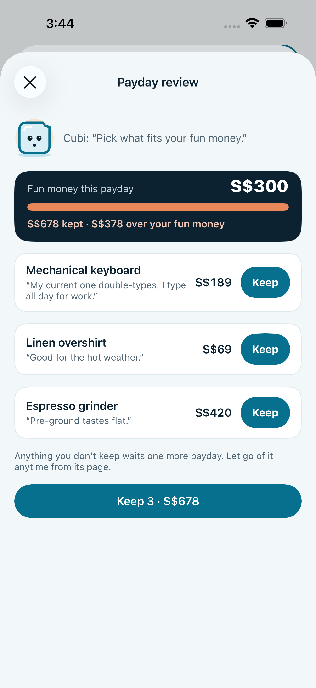 |

---

## 8. See what you saved

Total saved, payday streak, let-go rate, monthly chart and history.

| After review | Saved | Saved with history |
|---|---|---|
| 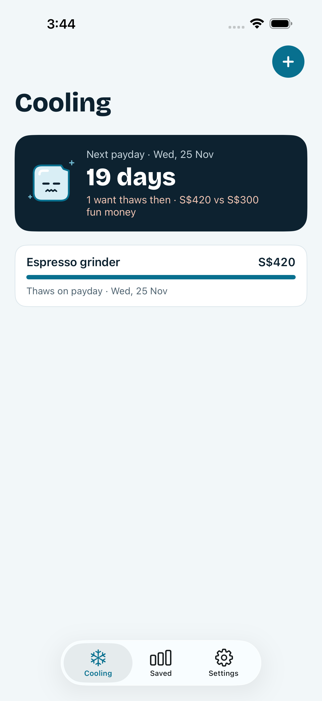 | 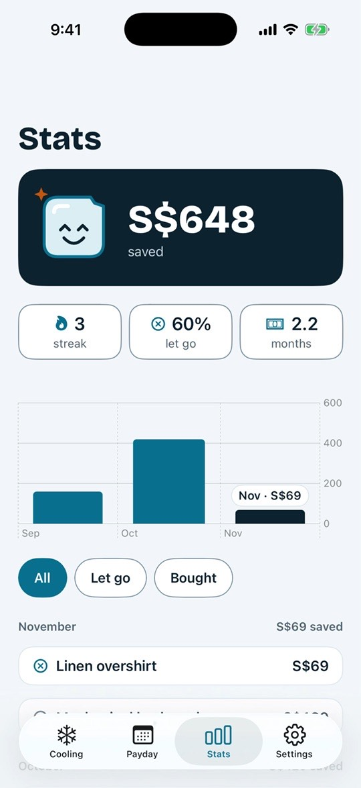 | 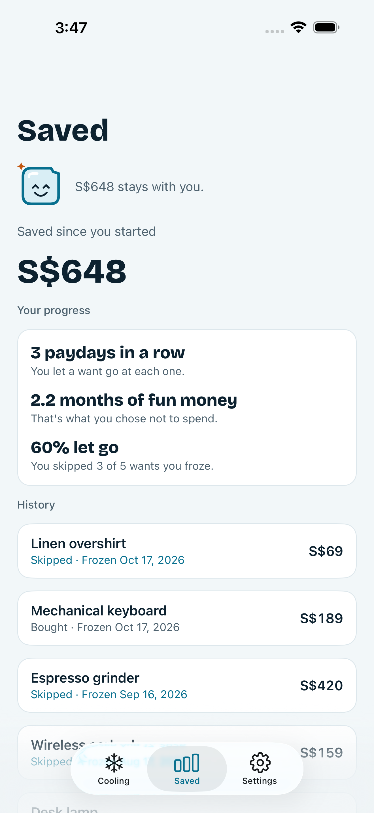 |

---

## 9. Built to be robust

| Settings | Landscape | Persists on relaunch |
|---|---|---|
| 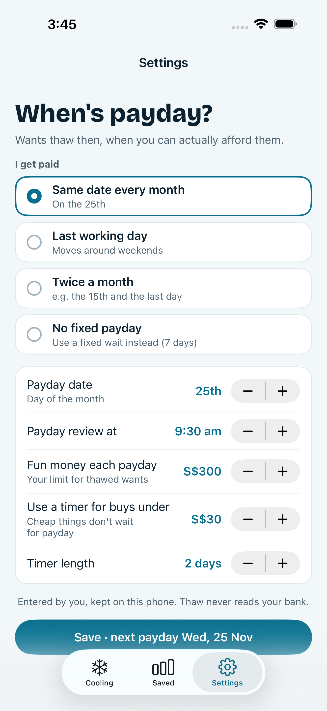 | 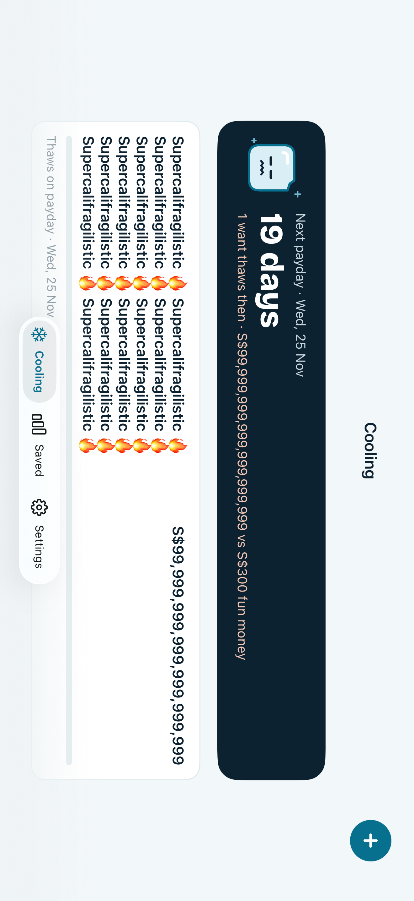 | 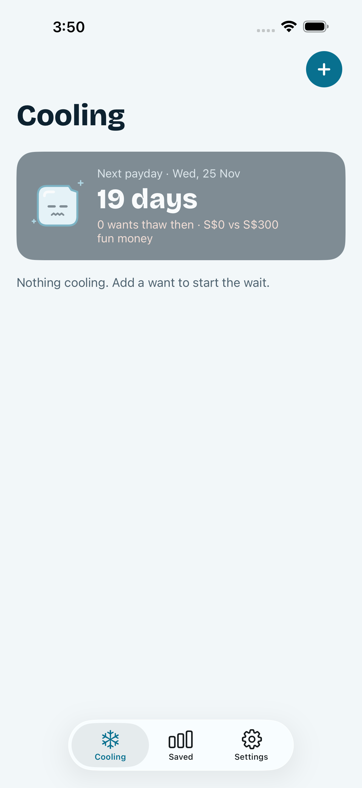 |

- Dynamic Type, VoiceOver actions, Reduce Motion support.
- No accounts, servers or analytics. Data stays on the device.
- Tested against persona walkthroughs (careful, lazy, hardcore) and accessibility audits.

---

## 10. Wrap-up

- **Freeze** it, **cool** it, **decide** on payday.
- iOS 17+, light mode, fully private.
- Website: https://seanyeote.github.io/thaw-cubi/

*Suggested flow: 1 → 3 → 5 → 7 → 8 live in the simulator. Use `-thawFixture thawed` or `history` for slides 7 and 8 (see the README launch arguments).*
